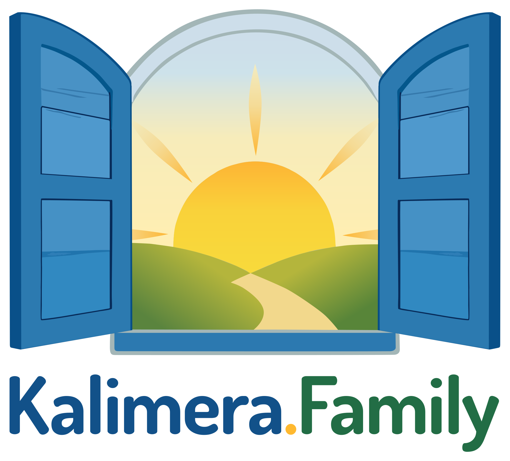
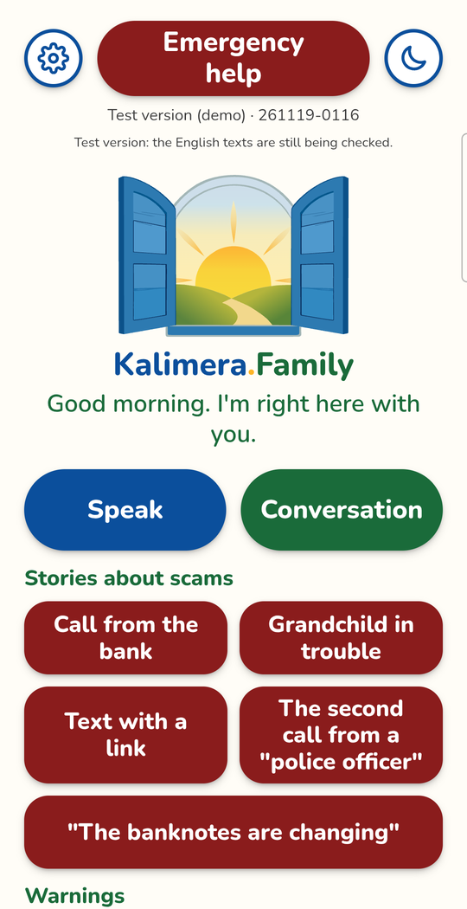
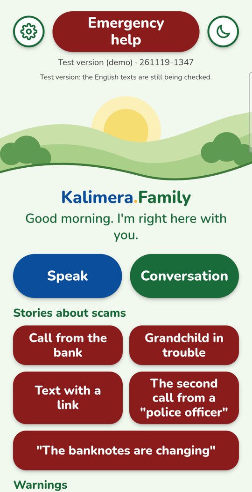
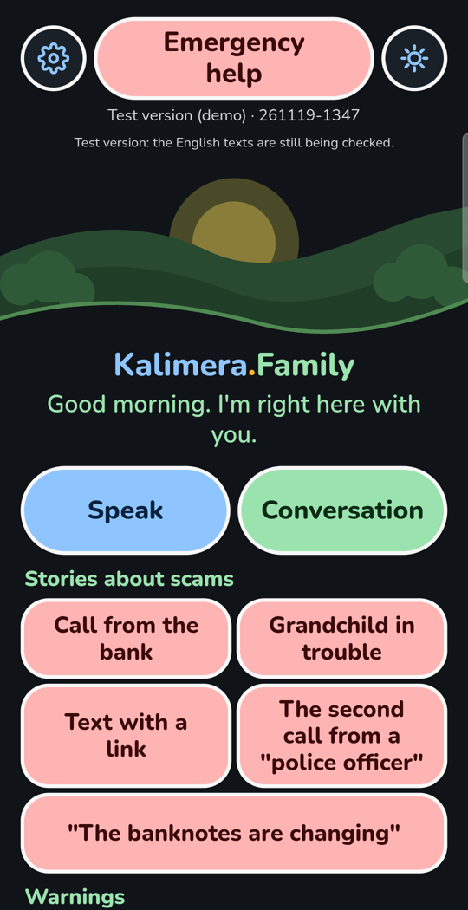
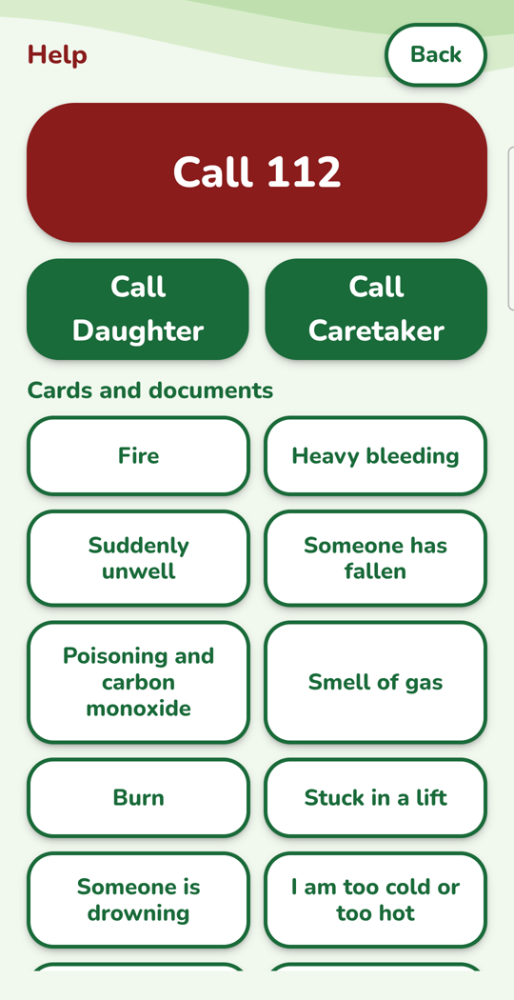
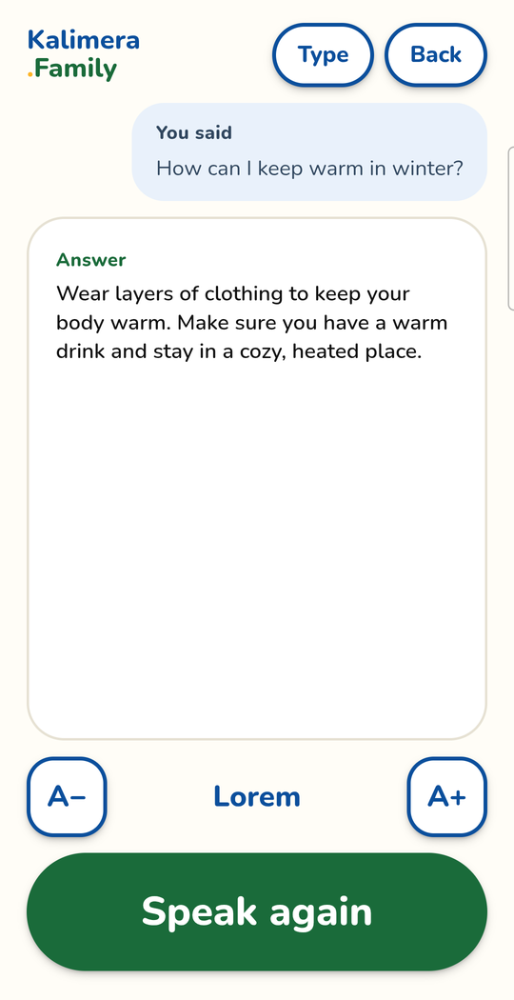
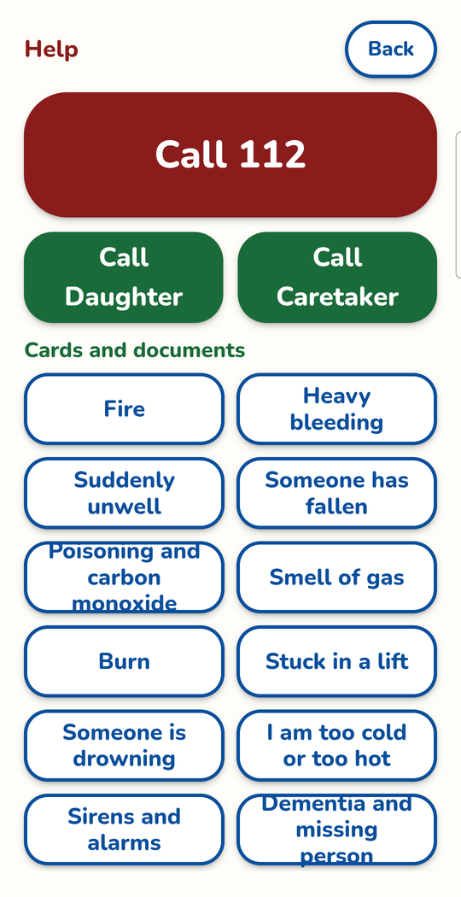

<p align="center"></p>

# Kalimera Family

**A private voice assistant for older people, in their own language, on an ordinary phone.**

Kalimera Family answers in one to three short sentences, reads the answer aloud and shows it in large letters. It warns about scams and gives calm, fixed help in an emergency. Speech recognition and answers run on the phone. The voice never leaves the device and no cloud AI is used.

> **Demo / test version.** This is a platform demonstration, not a medical device or a finished product. Emergency, first-aid, health and scam texts are drafts that have not yet been reviewed by doctors, emergency services, lawyers or native speakers. In an emergency, always call **112** (or your local number) yourself.

## Why

My mother is over 70. She asked a popular AI assistant a simple question and got about 1,800 characters back. She got lost halfway and gave up. She needed short answers, large text and her own language, without her questions going to a cloud. Kalimera Family is built for her and for people like her: older people who live alone or with a partner, people in care homes, and the families who worry about them from far away.

## What it does

| | |
|---|---|
| **Speak or type** | One big **Speak** button, or type the question. **Conversation** mode keeps listening for a back-and-forth talk. |
| **Short answers** | One to three sentences, read aloud and shown as a large caption. |
| **Emergency help** | Phrases such as "I fell down" or "my chest hurts" get a fixed, calm reply at once; no AI model is asked. The red **Emergency help** button opens **Call 112**, your own contacts and printable help cards. |
| **Scam warnings** | Short stories about common scams (fake bank call, "grandchild in trouble", fake police), read aloud. |
| **Knowledge cards** | Prepared answers for everyday questions on health, daily life, safety and practical steps, so they are not invented by a model. |
| **Name days** | "Whose name day is it today?" answered offline from a calendar for each country. |
| **Memory you control** | Nothing is remembered until the person agrees. "What do you remember about me?" and "Forget everything" work by voice. |
| **Easy to read** | Text size A+ / A−, light and dark themes, one colour per meaning (blue Speak, green Conversation, red Emergency). |
| **Languages** | Polish, English, German, Romanian. Greek is being improved and will come back later. The country (for example Austria or Germany, UK or Ireland) sets emergency numbers and local content. |

## Two looks, more on request

The app comes with two looks (skins), chosen in **Settings → Look of the app**: **Calm cards** (default) and **Green meadow**. Each has a light and a dark screen. Every look keeps the same colour for the same meaning: blue Speak, green Conversation, red Emergency help and scams. Other looks can be made on request, for example in a care home's own style, without changing how the app works.

<p align="center">   </p>

## Try it on Android

1. Download the APK from the **[app folder](app/)**: [`kalimera-family-0.2.1-demo-20261119.apk`](https://github.com/LDec-AlmostHuman/kalimera-family/raw/main/app/kalimera-family-0.2.1-demo-20261119.apk) (25 MB).
   SHA-256: `8ac71764e7ed651bac23687e852975e42ba13a52e761ba25b794fccad95a980c`
2. Open it on the phone and allow "Install from this source". Google Play Protect may warn about an unknown developer: tap **More details**, then **Install anyway**.
3. Choose your language and agree to the terms.
4. The app downloads its language files once over Wi-Fi: about **1.2 GB** for Polish, about **2.9 GB** for English, German or Romanian. After that it works without internet.

**Phone:** Android 8 or newer, 64-bit (arm64), **6 GB of memory or more**, about 3–4 GB of free storage.

The **[user manual](docs/USER_MANUAL.md)** ([PDF](docs/USER_MANUAL.pdf)) shows the main screens.

<p align="center">  </p>

An iPhone version exists (with natural voices for Polish, English and German) and is tested on real devices; it is not public yet.

## How it works (short)

```
Microphone ─► Whisper small (on the phone) ─► fixed steps first:
                                                 emergency phrases, clock, reference
                                                 values, knowledge cards,
                                                 scam warnings, sourced facts
                                              ─► small open model on the phone
                                                 (Gemma-4-E2B, or Bielik 1.5B for Polish)
                                              ─► optional care-home hub with a larger
                                                 open model (Gemma-4-26B-A4B)
           ◄── short answer, read aloud + large caption
```

About half of all questions are answered by the fixed steps, without any AI model. When the model has no source, it says so instead of guessing. More in **[How it works](docs/HOW_IT_WORKS.md)**, **[Privacy](docs/PRIVACY.md)** and **[Test results](docs/TEST_RESULTS.md)**.

## Status (19 November 2026)

- Working Android and iPhone apps, tested on a mid-range Galaxy A37 and an iPhone.
- First user: my mother (Polish); a Greek reviewer and Romanian and German testers help.
- Shared hub for care homes built and load-tested.
- Next: expert and native-speaker review of all safety and health content, natural voices for every language, pilots in homes and care homes in 2027.
- The source code will be published here under an open-source licence before the pilots. Test sets and reports will follow.

## Credits

Built on open models and tools: Whisper (OpenAI) and whisper.cpp, Gemma (Google), Bielik (SpeakLeash / ACK Cyfronet AGH), llama.cpp, Pocket TTS (Kyutai), Capacitor and Svelte. Name-day data comes from Wikipedia contributors (CC BY-SA 4.0) and trends.ro (CC BY 4.0). Full list: **[THIRD_PARTY_NOTICES.md](THIRD_PARTY_NOTICES.md)**, also in the app under Settings → About and licences.

## Videos

Demo clips and the introduction video: **[videos/](videos/)**.

## Contact

Łukasz, [kalimera.family](https://kalimera.family) · https://almostcyb.org - please fill contact us form there.

## Licences

- **Documents and screenshots** in this repository: [CC BY 4.0](LICENSE). You may share and adapt them with credit to Kalimera Family.
- **Name and logo** (Kalimera Family, `docs/images/Kalimera.Family-*.svg`): not covered by CC BY 4.0; please ask before using them.
- **Android test build (APK)**: contains the open-source parts listed in [THIRD_PARTY_NOTICES.md](THIRD_PARTY_NOTICES.md), each under its own licence. Full licence texts: [LICENSES/](LICENSES/).
- **Source code**: not published yet. It will be published here under an open-source licence before the pilots.
