# Kalimera Family: user manual

Android test version 0.2.1 (demo), 19 November 2026. The screenshots come from a Samsung Galaxy A37 with the app in English.

> **This is a test version.** Kalimera Family is not a doctor and not a medical device. The emergency, health and scam texts are drafts that experts have not checked yet. In an emergency, always call **112** (or your local number) yourself.

## 1. What you need
- An Android phone or tablet with Android 8 or newer, 64-bit, and **6 GB of memory or more**.
- About 3–4 GB of free storage.
- Wi-Fi for the first start.

## 2. Install
1. Download `kalimera-family-0.2.1-demo-20261119.apk` from the **app** folder of the project on GitHub.
2. Open the file on the phone. When Android asks, switch on **Allow from this source** and go back.
3. Tap **Install**. If Google Play Protect warns about an unknown developer, tap **More details**, then **Install anyway**. This is expected for a test version that is not in the Play Store.
4. Tap **Open**.

## 3. First start
1. **Choose your language** (English, Polski, Deutsch or Română) and tap **Continue**.
2. **Before we start:** the app explains that it is not a doctor, that your talks stay on the phone, and how to delete them. Tap **I agree**. Without that the app stays closed.
3. **One-time download:** the app needs its language files once: about 1.2 GB for Polish, or about 2.9 GB for English, German or Romanian. Tap **Download**, keep the app open and the screen on. If the download stops, tap **Download** again and it continues where it stopped. After that, the app works without internet.
4. The first time you press **Speak**, Android asks for the microphone. Choose **While using the app**. The sound never leaves the phone.

## 4. The Home screen

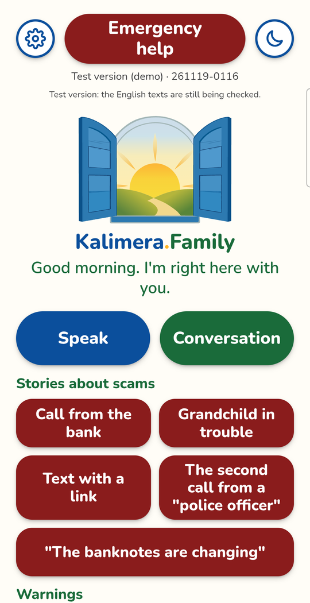

- **Emergency help** (red, at the top): Call 112, your own contacts, and help cards.
- **Settings** (gear, top left) and **light / dark screen** (moon, top right).
- **Speak** (blue): ask one question with your voice.
- **Conversation** (green): talk back and forth without pressing the button each time.
- **Stories about scams** (red tiles): short stories about common tricks, read aloud.
- **Warnings** (amber): for example carbon monoxide.

The line "Test version (demo)" shows the build date.

## 5. Ask a question

### By speaking

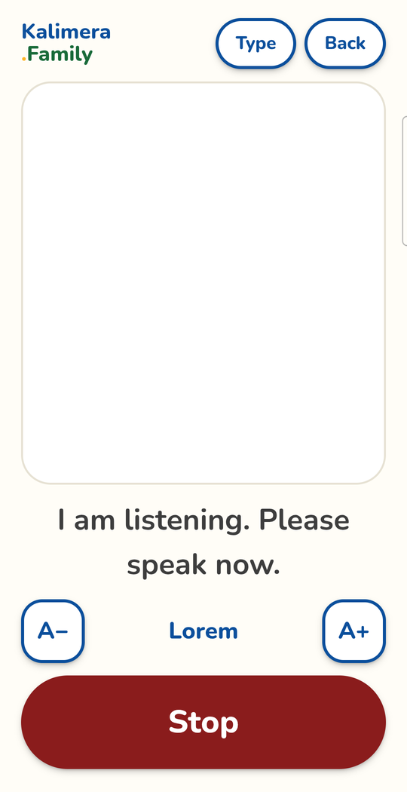

Press **Speak** and talk normally. When you stop talking, the app stops listening by itself. **Stop** ends listening at any time.

### By typing

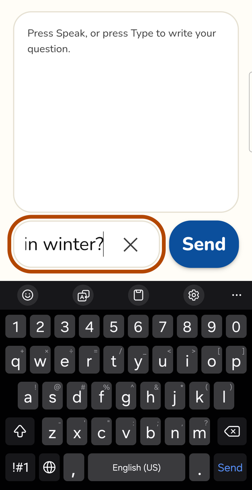

Press **Type**, write your question and press **Send**. The **X** clears the text.

### The answer

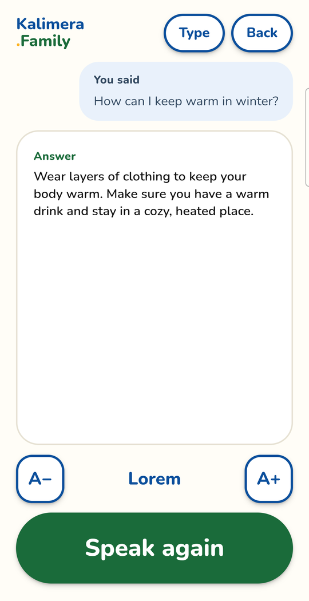

The answer is one to three short sentences. It appears in large letters and is read aloud.

- **Pause** and **Stop** while it is reading; **Speak again** for the next question.
- **A−** and **A+** make the text smaller or larger.
- **Back** returns to Home.

### Conversation

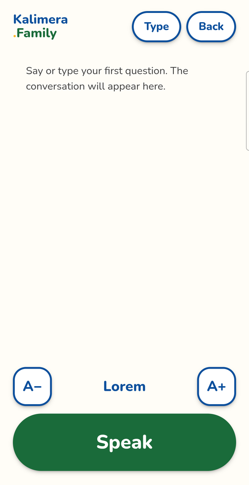

In **Conversation**, press **Speak** once. After each answer the app listens again by itself, so you can simply talk. **End conversation** stops it; **Back** returns to Home.

## 6. Emergency help

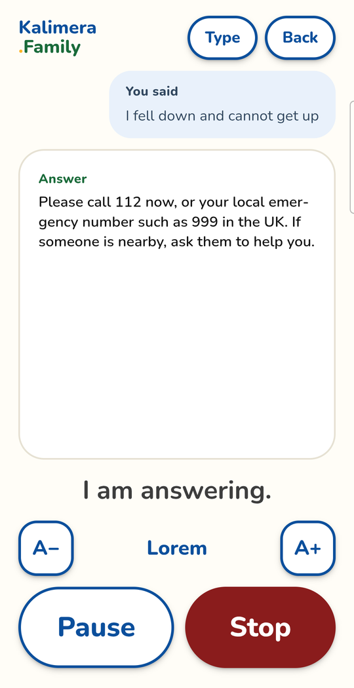

If you say or type something like "I fell down and cannot get up", "my chest hurts" or "help", the app does not ask any AI model. It answers at once with a fixed, calm message: call 112, or your local number such as 999 in the UK.

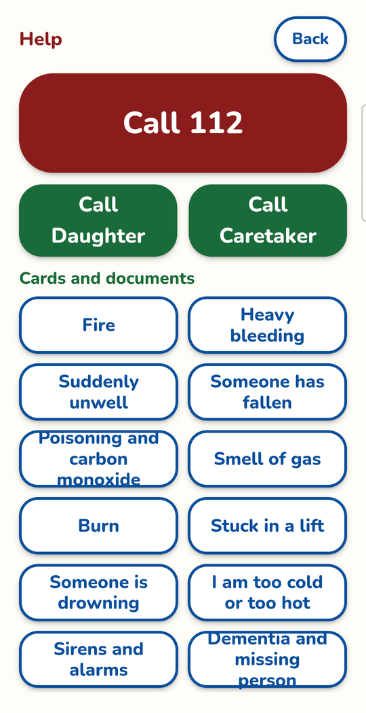

The red **Emergency help** button on Home opens:

- **Call 112**: a big button that starts the phone call.
- **Your own contacts**, for example a daughter or a carer. You set them in **Settings → Phone numbers**.
- **Cards and documents**: short instructions for fire, heavy bleeding, falls, smell of gas, burns, scams and more.

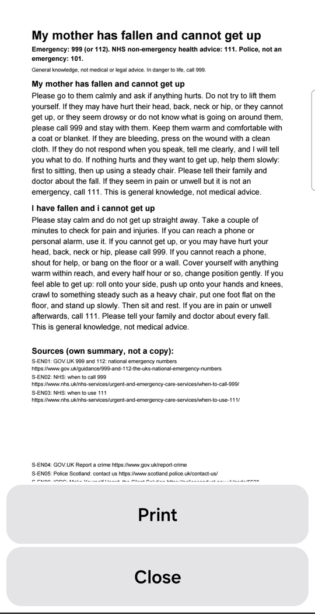

Each card opens as a document with the emergency numbers of your country and its sources. **Print** makes a paper copy for the fridge door.

## 7. Stories about scams

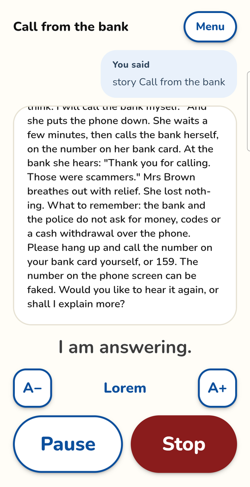

Tap a red tile, for example **Call from the bank**. The app reads a short story and ends with "What to remember". Afterwards you can say "again" to hear it again or "explain more". **Menu** lists all stories. **Pause** and **Stop** work while it reads.

## 8. Settings

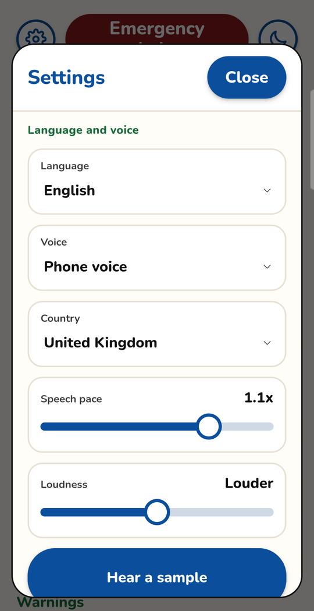 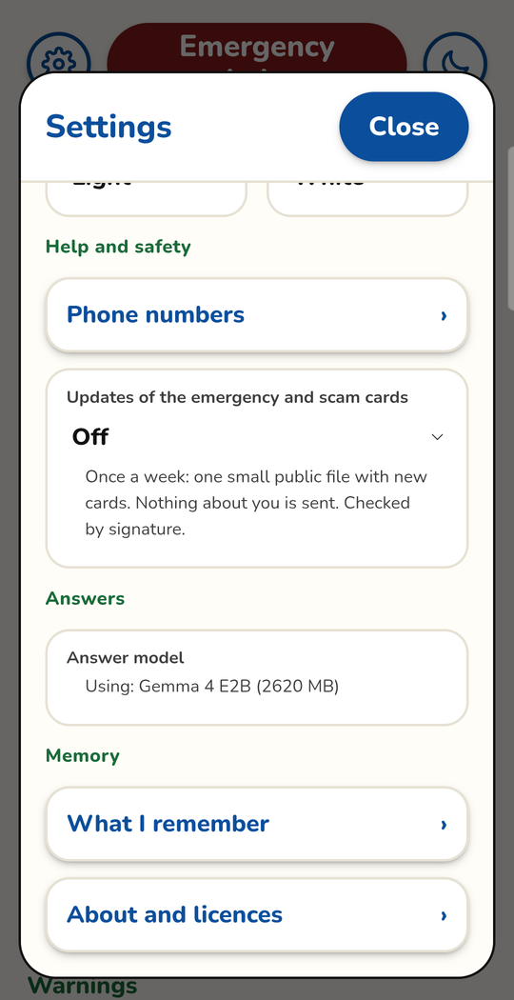

- **Language** and **Country**: the country sets emergency numbers, local services and name days (for example United Kingdom or Ireland, Germany, Austria or Switzerland).
- **Voice**: on Android the app uses the phone's own voice.
- **Speech pace** and **Loudness**, and **Hear a sample** to check them.
- **Text size**, **Look of the app**, **Screen** (light, dark or auto) and **Button outline**.
- **Phone numbers**: the contacts shown under Emergency help.
- **Updates of the emergency and scam cards**: off in this version.
- **Answer model**: which language model answers (Gemma for English, German and Romanian; Bielik for Polish).
- **What I remember** and **About and licences**.

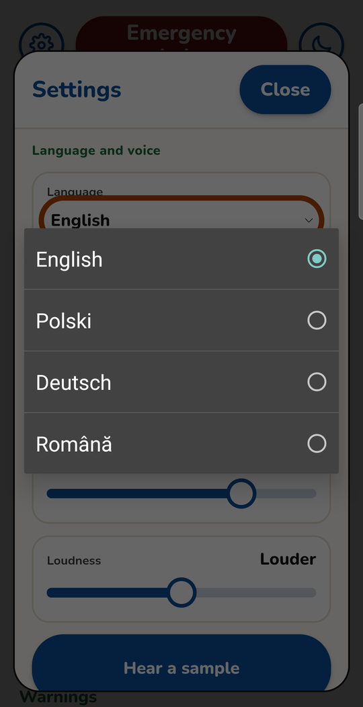

## 9. Your memory, your choice
- The app remembers your talks for 7 days, and short daily notes made of your own words, only on this phone.
- Say **"What do you remember about me?"** to hear what it keeps.
- Say **"Remember that…"** to keep a fact, for example "Remember that my daughter is called Anna".
- Say **"Forget everything"** to delete it all, or open **Settings → What I remember** to delete items one by one (press twice to confirm).
- Nothing is used to train AI models, and nothing is sold.

## 10. Light and dark screen

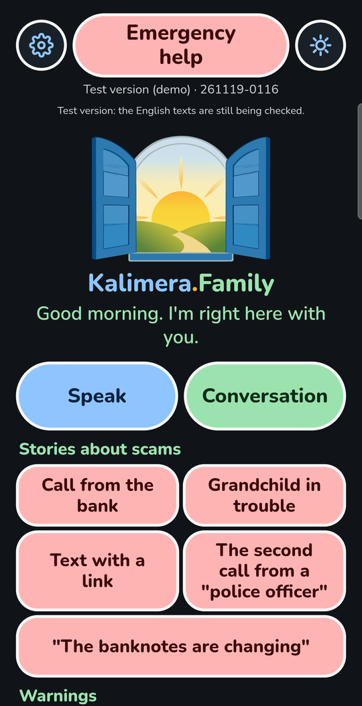

The moon button switches to the dark screen; the sun button switches back. The colours keep their meaning: blue for Speak, green for Conversation, red for emergency and scams.

## 11. Things you can say
- "What time is it?" · "What day is it today?"
- "Whose name day is it today?"
- "Louder" · "Slower" · "Repeat" · "Larger text"
- "Tell me a story about scams"
- "How can I keep warm in winter?"
- "What do you remember about me?" · "Forget everything"

## 12. Good to know
- Speak in a quiet room, at a normal distance from the phone.
- If the app is not sure what it heard, it asks "Did I hear you right?" instead of guessing.
- When it has no reliable source, it says so. A short "I don't know" is better than a wrong answer.
- The first answer after opening the app can take a few seconds while the language model loads.
- It gives no medicine doses and no diagnosis.
- To remove the app and everything it stored: Android **Settings → Apps → Kalimera Family → Uninstall**.

## 13. Licences
Built on open models and tools: Whisper, Gemma, Bielik, llama.cpp and others. Full list: **Settings → About and licences** and [THIRD_PARTY_NOTICES.md](../THIRD_PARTY_NOTICES.md).

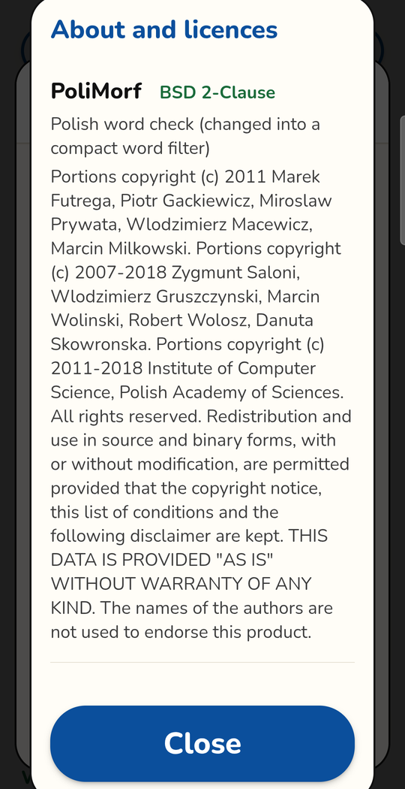
